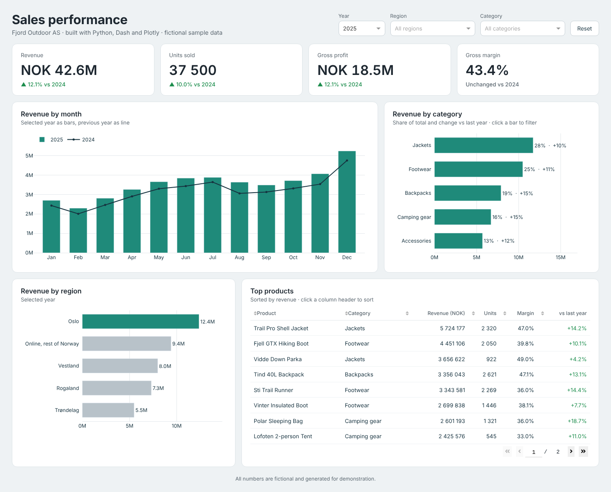

# Sales performance dashboard (Python, Dash, Plotly)

An interactive sales dashboard for a fictional outdoor retailer, Fjord Outdoor AS.
All data is generated by `make_data.py` and is not real.



## What it shows

- **Key figures:** revenue, units sold, gross profit and gross margin, each compared with the previous year
- **Revenue by month:** the selected year as bars, the previous year as a line
- **Revenue by category:** share of total and change vs last year
- **Revenue by region**
- **Top products:** a sortable table with revenue, units, margin and change vs last year

## Interactive features

- Filter by **year**, **region** and **category**
- **Click a category bar** to filter the whole dashboard to that category
- **Reset** button to clear all filters
- Hover any chart to see exact values
- Click a column header in the products table to sort it

## Run it

```bash
pip install -r requirements.txt
python app.py
```

Then open http://127.0.0.1:8050 in your browser.

## Use your own data

Replace `data/sales.csv` with a file that has the same columns:

| Column | Example |
| --- | --- |
| month | 2025-03-01 |
| region | Oslo |
| category | Jackets |
| product | Trail Pro Shell Jacket |
| units | 42 |
| revenue | 101 430.50 |
| gross_profit | 47 672.30 |

To make new sample data instead, run `python make_data.py`.

## Project structure

```
app.py            the dashboard (layout and callbacks)
make_data.py      generates the fictional sample data
data/sales.csv    the sample data
assets/style.css  styling (loaded automatically by Dash)
requirements.txt  Python packages
```

## Deploy

The app exposes `server = app.server`, so it can run on any host that runs Python web apps, for example with:

```bash
gunicorn app:server
```

Built by Eskander Snoussi.
